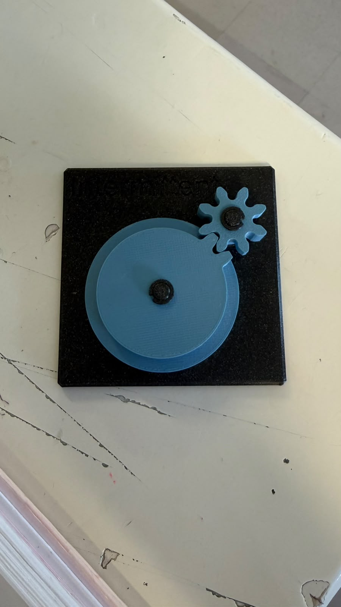
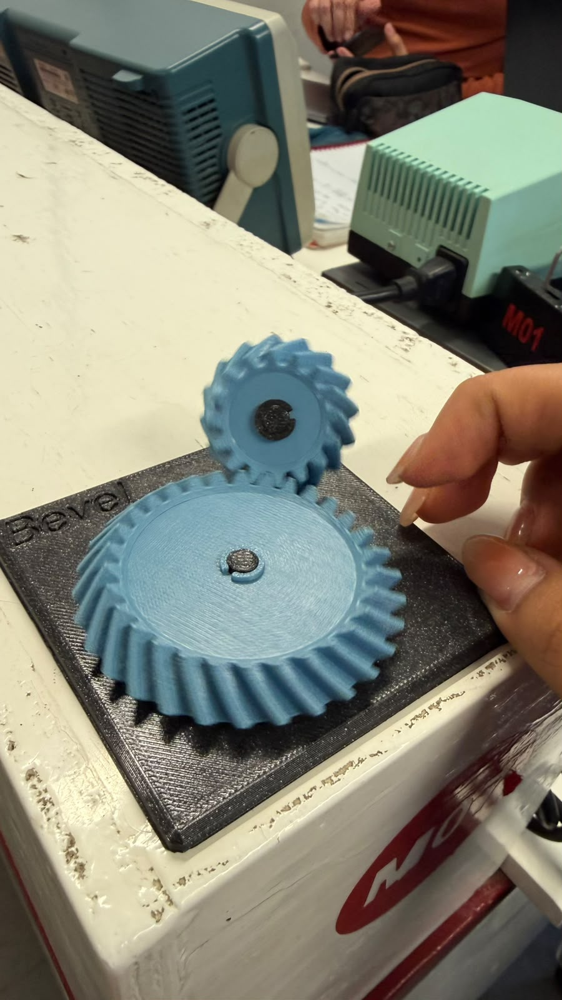
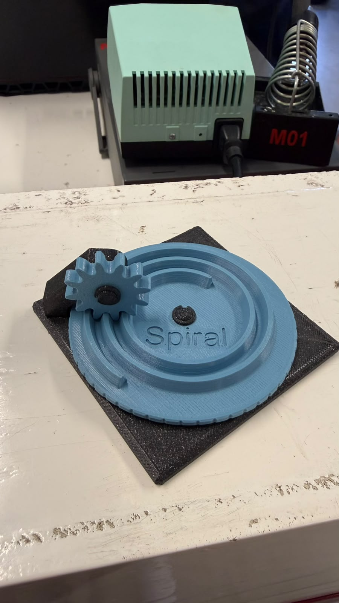
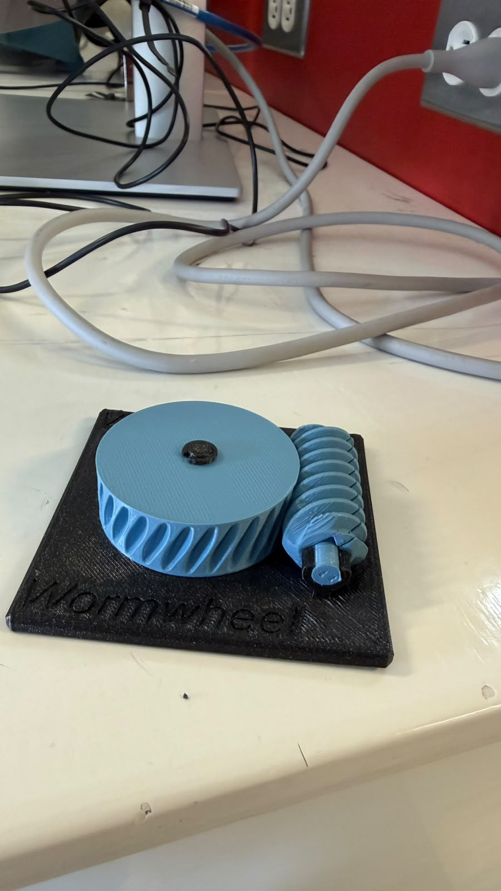
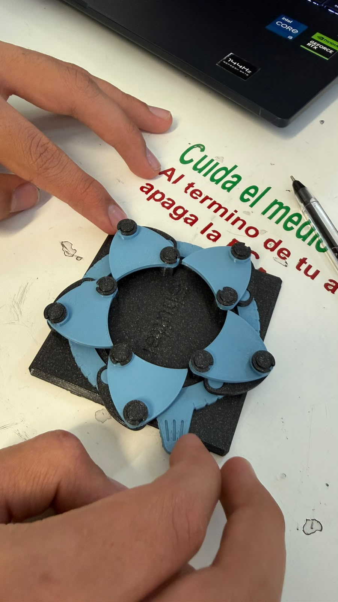
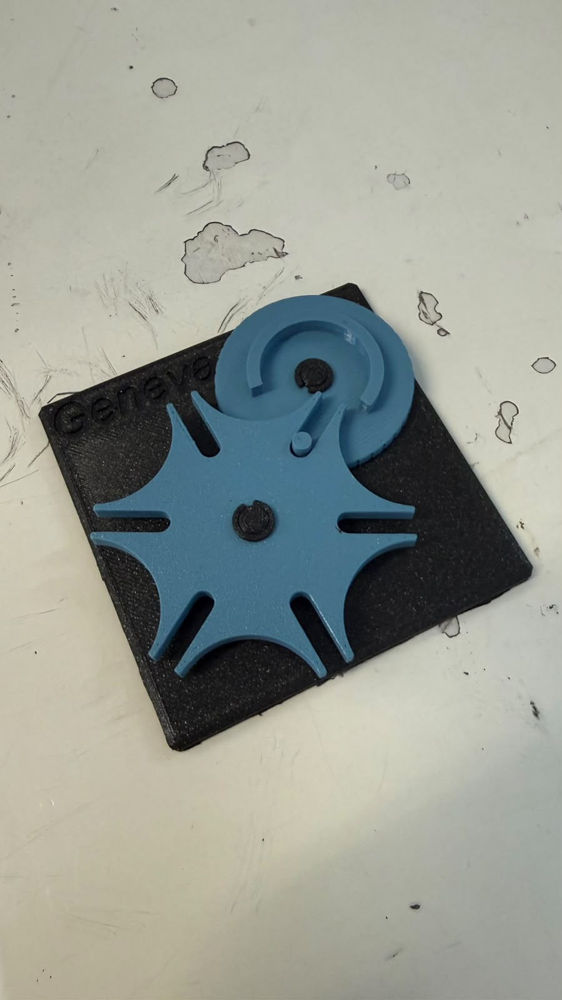
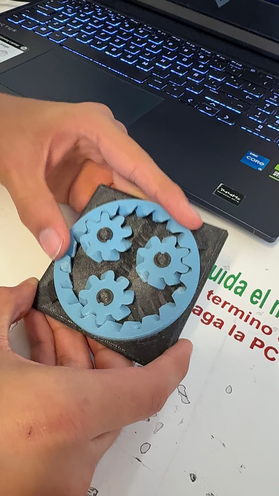
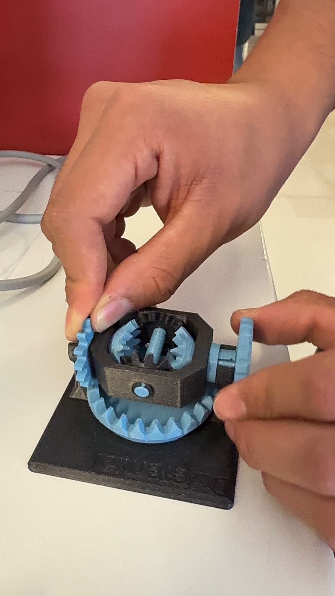
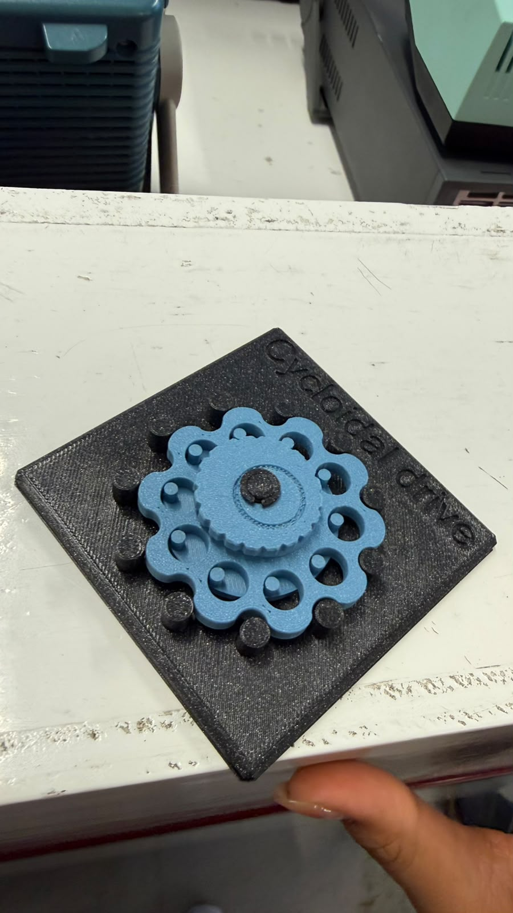

# Sesión 4 — Mecanismos

## Qué debía lograr hoy

- [✅] Entender cómo los mecanismos transforman el movimiento
- [✅] Calcular relaciones de transmisión simples

## Qué usé
- Planetary en 3D
- Bevel en 3D
- Spiral en 3D
- Cycloidal drive en 3D
- Worm/Worm drive en 3D
- Pulley en 3D
- Intermittent en 3D
- Geneva en 3D
- Universal joint en 3D
- Shutter en 3D
- Differential en 3D

*Un motor que gira rápido pero con poca fuerza puede entregar una salida lenta y potente si se usan engranes o bandas.*

## Qué hice y qué pasó (evidencia)
### Intermittent Mechanism

### Bevel Gear

### Universal Joint 

### Spiral 

### Worm Gear 

### Shutter

### Geneva Mechanism 

### Star Wheel Mechanism

### Differential

### Cycloidal Gear 

## Relación de transmisión
Si dos engranes están acoplados, con **Z1** dientes en el de entrada (motriz) 
y **Z2** dientes en el de salida (conducido), la relación de transmisión (i) es:

    i = Z2 / Z1 = w_entrada / w_salida = tau_salida / tau_entrada

### Interpretación

| Caso | Tipo | Qué pasa en la salida |
|------|------|-----------------------|
| **i > 1** | Reductor | Gira más lento y entrega más par (fuerza) |
| **i < 1** | Multiplicador | Gira más rápido y entrega menos par |

- La velocidad angular (w) y el par (tau) cambian en sentido contrario:
    - w2 = w1 / i
    - tau2 = tau1 * i   (sin contar las pérdidas por fricción)
- Un engrane no fabrica energía: solo la transforma. Lo que se gana en fuerza se pierde en velocidad, o al revés, dependiendo del número de dientes de cada engrane.

### Trenes de engranes compuestos

Si hay varias etapas en serie, la relación total es el **producto** de las relaciones de cada etapa. 
Ejemplo: una etapa de 1:4 seguida de otra de 1:16 da 4 × 16 = 64. Por eso una caja 
reductora tipo motor TT alcanza 1:48 ocupando muy poco espacio.

### Ejemplo resuelto

Un piñón de 12 dientes mueve un engrane de 36 dientes:

    i = 36 / 12 = 3

La salida gira a 1/3 de la velocidad de entrada, pero con 3 veces más par.

## Ejercicio: calcular la relación de transmisión

### Datos

| Caso | Motriz | Conducido | Dato conocido |
|------|--------|-----------|---------------|
| A | Z₁ = 5 | Z₂ = 10 | ω₂ = 10 rpm, τ₁ = 1 N·cm |
| B | Z₃ = 5 | Z₄ = 20 | ω₃ = 20 rpm, τ₃ = 4 N·cm |

**Qué se busca:** ω₁ y τ₂ en el caso A; ω₄ y τ₄ en el caso B.

### Caso A

    i_A = Z₂ / Z₁ = 10 / 5 = 2
    ω₁ = i_A · ω₂ = 2 · 10 = 20 rpm
    τ₂ = i_A · τ₁ = 2 · 1 = 2 N·cm

### Caso B

    i_B = Z₄ / Z₃ = 20 / 5 = 4
    ω₄ = ω₃ / i_B = 20 / 4 = 5 rpm
    τ₄ = i_B · τ₃ = 4 · 4 = 16 N·cm

### Resultados

| Caso | i | Velocidad | Par |
|------|---|-----------|-----|
| A | 2 | Entrada ω₁ = 20 rpm, salida ω₂ = 10 rpm | τ₂ = 2 N·cm |
| B | 4 | Salida ω₄ = 5 rpm | τ₄ = 16 N·cm |

**Conclusión:** en los dos casos i > 1, o sea que el sistema baja la velocidad y sube el par en la misma proporción.

---
## Tabla de estaciones
| Estación | ¿Qué transforma? | Relación i estimada | ¿Reversible o autobloqueante? | ¿Dónde lo has visto en la vida real? | ¿Dónde serviría en el carro o en un proyecto tuyo? |
|----------|------------------|---------------------|-------------------------------|--------------------------------------|-----------------------------------------------------|
| A - Diferencial | Reparte una entrada de giro en dos salidas que pueden ir a distinta velocidad con el mismo par | Corona-piñón de ≈ 3:1 a 4:1; satélites 1:1; entre salidas ~1:1 en recta y variable en curva | Reversible, NO autobloqueante | Eje trasero/delantero de un carro | Permite que las ruedas giren distinto en las curvas; ruedas independientes de un robot que da vuelta |
| B - Cicloidal | Velocidad ↔ par: gran reducción en poco espacio y con poco juego (backlash) | Alta, típico 30:1 a 100:1+ (se cuentan las vueltas de entrada por cada una de salida) | Reversible pero con mucha fricción interna; casi autobloqueante | Modelo de práctica (engrane azul con lóbulos internos); articulaciones de robots industriales | Articulaciones de robots, dirección asistida; reductor compacto para un brazo de precisión |
| C - Cardán | Cambio de eje: transmite el giro entre ejes con ángulo; la salida acelera y frena dos veces por vuelta | 1:1 en promedio, con fluctuación | Reversible, NO autobloqueante | Modelo de práctica (junta azul); flecha cardán del carro | Flecha entre la caja de velocidades y el diferencial; mover una rueda con ángulo variable |
| D - Obturador | De continuo a intermitente: una sola entrada mueve varias láminas sincronizadas (no usa dientes) | Depende del número de láminas | Reversible, NO autobloqueante | Modelo de práctica (obturador negro con aspas azules); diafragma de una cámara | Iris para regular el paso de aire o luz; apertura/cierre en un proyecto |
| E1a - Cónico recto (Bevel) | Cambio de eje a 90° con dientes rectos en forma de cono | i = Z₂/Z₁ (se cuentan los dientes de piñón y corona) | Reversible | Transmisiones de taladros manuales y mecanismos angulares | Cambiar la dirección del giro del motor hacia las ruedas |
| E1b - Cónico espiral (Spiral) | Cambio de eje a 90° con dientes curvos en espiral, de contacto más suave y silencioso que el recto | i = Z₂/Z₁ (se cuentan los dientes de piñón y corona) | Reversible | Diferenciales de camionetas y autos | Par cónico del diferencial trasero |
| E2a - Engrane intermitente (Intermittent) | De continuo a intermitente: la entrada gira sin parar y la salida avanza con pausas | Depende de los dientes y de las pausas por vuelta | NO autobloqueante | Mecanismos de avance por pasos (contadores, juguetes) | Hacer que una pieza avance por pasos |
| E2b - Ginebra (Geneva) | De continuo a intermitente: cada vuelta de entrada mueve la salida un paso fijo | 1 vuelta de entrada = 1/n de vuelta de salida, con n ranuras | Se traba durante la pausa | Proyectores de cine antiguos, relojes mecánicos | Indexar posiciones (selector o carrusel) |
| F - Planetario (Planetary) | Velocidad ↔ par: reducción compacta con ejes en el mismo centro | Depende de qué elemento se fije (sol, planetas o corona) | Reversible | Cajas automáticas, taladros y atornilladores eléctricos | Reducción compacta en un motorreductor |
| G - Tornillo sin fin (Worm) | Cambio de eje a 90° con una reducción muy grande en una sola etapa | i = Z_rueda / entradas del tornillo | Autobloqueante (la rueda no logra mover al tornillo) | Clavijas de guitarra, elevadores y portones | Cualquier mecanismo que no deba retroceder al apagar el motor |
| H - Polea (Pulley) | Velocidad ↔ par mediante una banda entre dos ejes separados | i = D₂/D₁ (diámetros de las poleas) | Reversible | Banda del motor en un auto, máquinas de coser | Llevar el giro del motor a un eje alejado |

> Nota: la columna de vida real de E1a, E1b, E2a, E2b, F, G y H la llené con ejemplos comunes; confírmalos con tus modelos o con tu profe.

## Qué falló y cómo lo resolví

- **Síntoma:** No me coincidía el resultado del ejemplo (piñón de 12 dientes 
  moviendo un engrane de 36). Dudaba si i = Z1/Z2 o i = Z2/Z1 y no tenía claro 
  qué significaba el número que salía. En el ejercicio de 5 y 10 dientes me daba 
  i = 1/2, pero con la fórmula de la teoría salía i = 2.
- **Cómo lo encontré:** Comparé mi cálculo con el ejemplo resuelto (i = 36/12 = 3) 
  y vi que las dos definiciones estaban al revés: en mi cuaderno usaba 
  Z_motriz / Z_conducido y la teoría usa Z_conducido / Z_motriz. También noté 
  que cuando el conducido tiene más dientes la salida gira más lento, así que 
  la velocidad se divide entre i y el par se multiplica por i.
- **Solución:** Me quedé con una sola convención para toda la práctica: 
  i = Z_conducido / Z_motriz, con Z2 (el