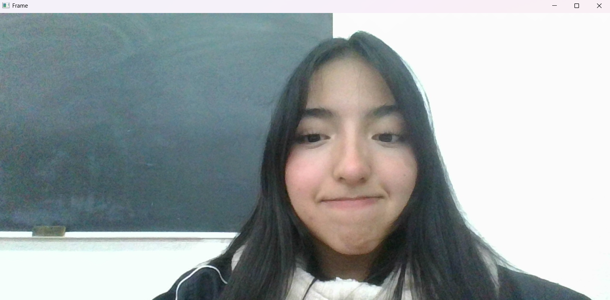
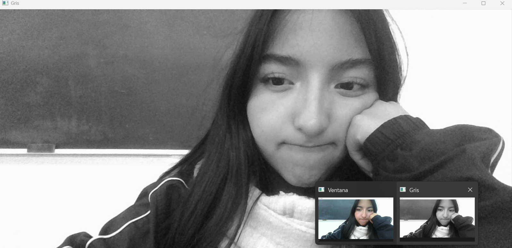
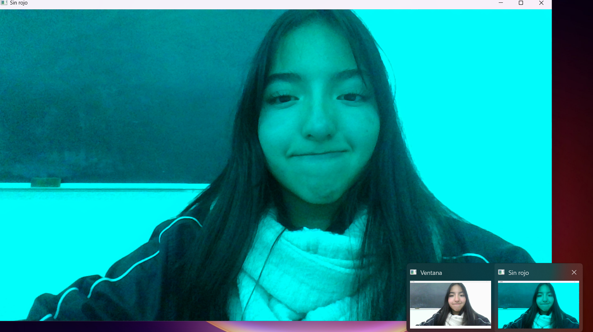
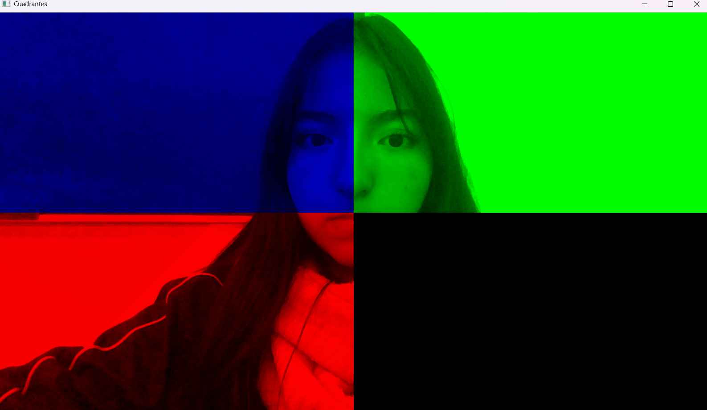
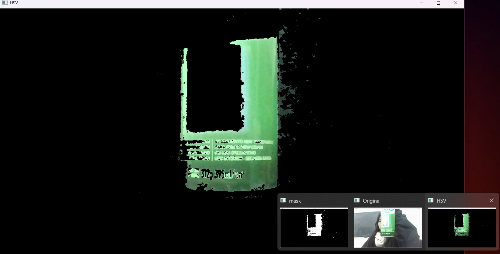
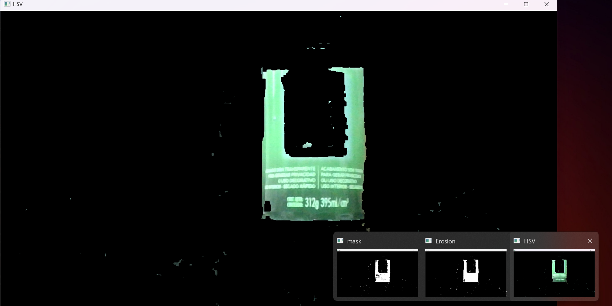
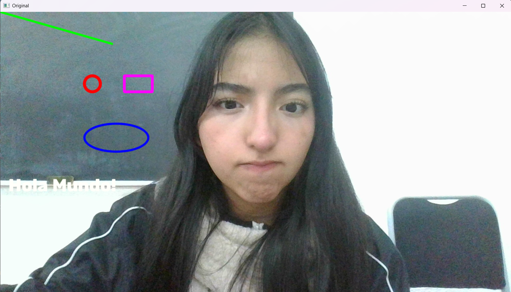
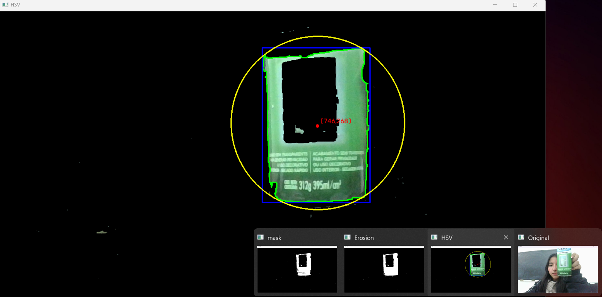
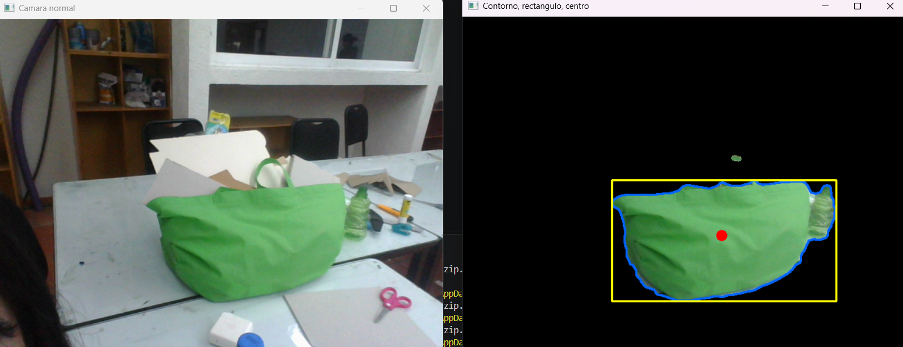

# Sesión N — Visión 101 con OpenCV

## Objetivos de la sesión
- [✅] 01 · Activar la cámara con `cv2.VideoCapture(0)` y reproducir el video en tiempo real a 1280×720.
- [✅] 02 · Pasar el video de un espacio de color a otro (BGR → GRAY / RGB / HSV) e imprimir algunos píxeles para entender que una imagen es una matriz de números.
- [✅] 03 · Anular un canal de color (dejar una capa en 0), recordando que OpenCV usa el orden BGR.
- [✅] 04 · Partir la imagen en 4 cuadrantes mediante *slicing* y asignar un color distinto a cada uno.
- [✅] 05 · Aislar un color en HSV con `cv2.inRange` y `cv2.bitwise_and`.
- [✅] 06 · Depurar la máscara con dilatación y erosión (operación de cierre) usando un kernel de 5×5.
- [✅] 07 · Trazar línea, círculo, elipse, rectángulo y texto encima del video.
- [✅] 08 · Programa final: máscara → depuración → contornos → centroide mediante `cv2.moments`.
- [✅] 09 · Versión optimizada del programa final: filtro de mediana → HSV → apertura y cierre con kernel elíptico de 9×9 → contornos → centroide.
- [✅] Extra · Comparar el 08 contra el 09 y pensar cómo usar el centroide para guiar el carrito.

## Materiales
- Una cámara web
- Python 3.12 / 3.13 y VS Code
- Un objeto verde de color uniforme

## Desarrollo y resultados

### Código 01 — `01_camara_base.py`
```python
# 01 - Estructura base: abrir la cámara y mostrar el video en vivo
import cv2

cap = cv2.VideoCapture(0)  # prueba 0/1/2 si tienes varias cámaras
if not cap.isOpened():
    raise RuntimeError("No se pudo abrir la cámara")

# Opcional: fija resolución (si la cámara lo permite)
cap.set(cv2.CAP_PROP_FRAME_WIDTH, 1280)
cap.set(cv2.CAP_PROP_FRAME_HEIGHT, 720)

while True:
    ok, frame = cap.read()
    if not ok:
        break

    cv2.imshow("Frame", frame)
    if cv2.waitKey(1) & 0xFF == ord('q'):  # presiona 'q' para salir
        break

cap.release()
cv2.destroyAllWindows()
```



### Código 02 — `02_espacios_de_color.py`
```python
# 02 - Recolor: cambiar el espacio de color del video (BGR -> GRAY / RGB / HSV)
import cv2

cap = cv2.VideoCapture(0)
if not cap.isOpened():
    raise RuntimeError("No se pudo abrir la cámara")

cap.set(cv2.CAP_PROP_FRAME_WIDTH, 1280)
cap.set(cv2.CAP_PROP_FRAME_HEIGHT, 720)

while True:
    ok, frame = cap.read()
    if not ok:
        break
    # OG frame

    # Cambia la constante para probar otros espacios de color:
    #   cv2.COLOR_BGR2GRAY  -> escala de grises (1 canal)
    #   cv2.COLOR_BGR2RGB   -> invierte el orden de los canales
    #   cv2.COLOR_BGR2HSV   -> Matiz, Saturación, Valor
    gray = cv2.cvtColor(frame, cv2.COLOR_BGR2GRAY)

    cv2.imshow("Ventana", frame)  # Muestra la foto original
    cv2.imshow("Gris", gray)
    if cv2.waitKey(1) & 0xFF == ord('q'):  # presiona 'q' para salir
        # Imprime un pedacito de la imagen para ver cómo se guardan los números
        print(frame[0:3, 0:3])
        break

cap.release()
cv2.destroyAllWindows()
```


### Código 03 — `03_quitar_canal.py`
```python
# 03 - Quitar un canal de color (poner una capa en 0)
# OpenCV guarda la imagen como [alto][ancho][canal] en orden BGR:
#   BLUE 0 | GREEN 1 | RED 2
import cv2

cap = cv2.VideoCapture(0)
if not cap.isOpened():
    raise RuntimeError("No se pudo abrir la cámara")

cap.set(cv2.CAP_PROP_FRAME_WIDTH, 1280)
cap.set(cv2.CAP_PROP_FRAME_HEIGHT, 720)

while True:
    ok, frame = cap.read()
    if not ok:
        break
    # OG frame

    no_color = frame.copy()
    no_color[:, :, 2] = 0   # quita el rojo (prueba con 0 o 1)

    # También se puede hacer solo en una zona (filas 0-360, toda la anchura):
    # no_color[0:360, :, 2] = 0

    cv2.imshow("Ventana", frame)  # Muestra la foto
    cv2.imshow("Sin rojo", no_color)
    if cv2.waitKey(1) & 0xFF == ord('q'):  # presiona 'q' para salir
        break

cap.release()
cv2.destroyAllWindows()
```


### Código 04 — `04_cuadrantes.py`
```python
# 04 - Dividir la imagen (1280x720) en 4 cuadrantes y dejar un color en cada uno
#   BLUE 0 | GREEN 1 | RED 2
import cv2

cap = cv2.VideoCapture(0)
if not cap.isOpened():
    raise RuntimeError("No se pudo abrir la cámara")

cap.set(cv2.CAP_PROP_FRAME_WIDTH, 1280)
cap.set(cv2.CAP_PROP_FRAME_HEIGHT, 720)

while True:
    ok, frame = cap.read()
    if not ok:
        break
    # OG frame

    no_color = frame.copy()
    # Arriba-izquierda: solo AZUL (quita rojo y verde)
    no_color[0:360, 0:640, 2] = 0
    no_color[0:360, 0:640, 1] = 0

    # Abajo-izquierda: solo ROJO (quita azul y verde)
    no_color[360:720, 0:640, 0] = 0
    no_color[360:720, 0:640, 1] = 0

    # Arriba-derecha: solo VERDE (quita rojo y azul)
    no_color[0:360, 640:1280, 2] = 0
    no_color[0:360, 640:1280, 0] = 0

    # Abajo-derecha: NEGRO (quita los tres canales)
    no_color[360:720, 640:1280, 2] = 0
    no_color[360:720, 640:1280, 0] = 0
    no_color[360:720, 640:1280, 1] = 0

    # Variante vista en clase (cian / magenta / amarillo):
    # quitar SOLO un canal por cuadrante, p. ej.
    # no_color[0:360, 0:640, 2] = 0       -> cian
    # no_color[360:720, 0:640, 1] = 0     -> magenta
    # no_color[0:360, 640:1280, 0] = 0    -> amarillo

    cv2.imshow("Cuadrantes", no_color)
    if cv2.waitKey(1) & 0xFF == ord('q'):  # presiona 'q' para salir
        break

cap.release()
cv2.destroyAllWindows()
```


### Código 05 — `05_segmentacion_hsv.py`
```python
# 05 - Segmentación por color en HSV (máscara)
# En OpenCV: H (matiz) va de 0-179, S y V van de 0-255.
import cv2
import numpy as np

cap = cv2.VideoCapture(0)
if not cap.isOpened():
    raise RuntimeError("No se pudo abrir la cámara")

cap.set(cv2.CAP_PROP_FRAME_WIDTH, 1280)
cap.set(cv2.CAP_PROP_FRAME_HEIGHT, 720)

while True:
    ok, frame = cap.read()
    if not ok:
        break
    # OG frame
    hsv = cv2.cvtColor(frame, cv2.COLOR_BGR2HSV)

    # Rango de VERDE (ajusta según tu iluminación)
    low  = np.array([35,  60,  60], dtype=np.uint8)
    high = np.array([85, 255, 255], dtype=np.uint8)
    # Para AZUL se probó: low=[100, 60, 60], high=[130, 255, 255]

    filtro = cv2.inRange(hsv, low, high)                       # máscara blanco/negro
    filtrada = cv2.bitwise_and(frame, frame, mask=filtro)      # solo el color elegido

    cv2.imshow("mask", filtro)
    cv2.imshow("Original", frame)  # Muestra la foto
    cv2.imshow("HSV", filtrada)
    if cv2.waitKey(1) & 0xFF == ord('q'):  # presiona 'q' para salir
        break

cap.release()
cv2.destroyAllWindows()
```


### Código 06 — `06_morfologia.py`
```python
# 06 - Limpieza morfológica de la máscara (erosión y dilatación)
import cv2
import numpy as np

cap = cv2.VideoCapture(0)
if not cap.isOpened():
    raise RuntimeError("No se pudo abrir la cámara")

cap.set(cv2.CAP_PROP_FRAME_WIDTH, 1280)
cap.set(cv2.CAP_PROP_FRAME_HEIGHT, 720)
kernel = cv2.getStructuringElement(cv2.MORPH_RECT, (5, 5))  # "pincel" de 5x5

while True:
    ok, frame = cap.read()
    if not ok:
        break
    # OG frame
    hsv = cv2.cvtColor(frame, cv2.COLOR_BGR2HSV)
    low  = np.array([35,  60,  60], dtype=np.uint8)
    high = np.array([85, 255, 255], dtype=np.uint8)
    filtro = cv2.inRange(hsv, low, high)

    # En clase se probó primero erode(iterations=10) y dilate(iterations=100)
    # para ver el efecto exagerado. Versión final (dilatar y luego erosionar = cierre):
    erosion = cv2.dilate(filtro, kernel, iterations=2)
    erosion = cv2.erode(erosion, kernel, iterations=2)

    filtrada = cv2.bitwise_and(frame, frame, mask=erosion)
    cv2.imshow("mask", filtro)
    cv2.imshow("Erosion", erosion)
    cv2.imshow("HSV", filtrada)
    if cv2.waitKey(1) & 0xFF == ord('q'):  # presiona 'q' para salir
        break

cap.release()
cv2.destroyAllWindows()
```


### Código 07 — `07_dibujar.py`
```python
# 07 - Dibujar figuras y texto sobre el video
import cv2

cap = cv2.VideoCapture(0)
if not cap.isOpened():
    raise RuntimeError("No se pudo abrir la cámara")

cap.set(cv2.CAP_PROP_FRAME_WIDTH, 1280)
cap.set(cv2.CAP_PROP_FRAME_HEIGHT, 720)

while True:
    ok, frame = cap.read()
    if not ok:
        break

    #cv2.line(imagen, punto1, punto2, color, grosor, tipo de linea)
    cv2.line(frame, (0, 0), (280, 80), (0, 255, 0), thickness=3, lineType=cv2.LINE_AA)
    #cv2.circle(imagen, centro, radio, color, grosor (-1 es lleno), tipo de linea)
    cv2.circle(frame, (230, 180), 20, (0, 0, 255), thickness=5, lineType=cv2.LINE_AA)
    #cv2.ellipse(imagen, centro, (ancho, alto), angulo, inicio, fin, color, grosor, tipo de linea)
    cv2.ellipse(frame, (290, 315), (80, 35), 0, 0, 360, (255, 0, 0), thickness=3, lineType=cv2.LINE_AA)
    #cv2.rectangle(imagen, punto1, punto2, color, grosor, tipo de linea)
    cv2.rectangle(frame, (310, 160), (380, 200), (255, 0, 255), thickness=5, lineType=cv2.LINE_8)
    #cv2.putText(imagen, texto, punto, fuente, escala, color, grosor, tipo de linea)
    cv2.putText(frame, "Hola Mundo!", (20, 450), cv2.FONT_HERSHEY_COMPLEX, 1.5, (250, 255, 255), 2, cv2.LINE_AA)

    '''
    cv2.LINE_8: Conectividad de 8, predeterminado, conexión diagonal y ortogonal.
    cv2.LINE_4: Conectividad de 4, solo conexión ortogonal.
    cv2.LINE_AA: Línea suavizada (anti-aliasing), líneas más suaves y estéticas.
    '''

    cv2.imshow("Original", frame)
    if cv2.waitKey(1) & 0xFF == ord('q'):  # presiona 'q' para salir
        break

cap.release()
cv2.destroyAllWindows()
```


### Código 08 — `08_contornos_centroides.py`
```python
# 08 - Programa final de la clase: color -> limpieza -> contornos -> centro
import cv2  # Importar libreria de vision OPENCV
import time
import numpy as np

cap = cv2.VideoCapture(0)  # prueba 0/1/2 si tienes varias cámaras

if not cap.isOpened():
    raise RuntimeError("No se pudo abrir la cámara")

# Opcional: fija resolución (si la cámara lo permite)
cap.set(cv2.CAP_PROP_FRAME_WIDTH, 1280)
cap.set(cv2.CAP_PROP_FRAME_HEIGHT, 720)
kernel = cv2.getStructuringElement(cv2.MORPH_RECT, (5, 5))

while True:
    ok, frame = cap.read()
    if not ok:
        break
    # OG frame
    hsv = cv2.cvtColor(frame, cv2.COLOR_BGR2HSV)
    #BLUE 0
    #GREEN 1
    #RED 2
    low  = np.array([35,  60,  60], dtype=np.uint8)
    high = np.array([85, 255, 255], dtype=np.uint8)
    filtro = cv2.inRange(hsv, low, high)
    erosion = cv2.dilate(filtro, kernel, iterations=2)
    erosion = cv2.erode(erosion, kernel, iterations=2)
    filtrada = cv2.bitwise_and(frame, frame, mask=erosion)
    contours, _ = cv2.findContours(erosion, cv2.RETR_EXTERNAL, cv2.CHAIN_APPROX_SIMPLE)
    for c in contours:
        area = cv2.contourArea(c)
        if area < 200:  # filtra ruido muy pequeño
            continue

        # Dibujo del contorno:
        cv2.drawContours(filtrada, [c], -1, (0, 255, 0), 2)

        # Rectángulo axis-aligned:
        x, y, w, h = cv2.boundingRect(c)
        cv2.rectangle(filtrada, (x, y), (x + w, y + h), (255, 0, 0), 2)

        # Círculo mínimo envolvente:
        (cx, cy), rad = cv2.minEnclosingCircle(c)
        cv2.circle(filtrada, (int(cx), int(cy)), int(rad), (0, 255, 255), 2)

        # Centroides con momentos:
        M = cv2.moments(c)
        if M["m00"] != 0:
            cx_m = int(M["m10"] / M["m00"])
            cy_m = int(M["m01"] / M["m00"])
            cv2.circle(filtrada, (cx_m, cy_m), 4, (0, 0, 255), -1)
            cv2.putText(filtrada, f"({cx_m},{cy_m})", (cx_m + 6, cy_m - 6),
                        cv2.FONT_HERSHEY_SIMPLEX, 0.5, (0, 0, 255), 1)

    cv2.imshow("mask", filtro)
    cv2.imshow("Erosion", erosion)
    # Muestra la foto
    cv2.imshow("HSV", filtrada)
    cv2.imshow("Original", frame)

    if cv2.waitKey(1) & 0xFF == ord('q'):
        break

cap.release()
cv2.destroyAllWindows()
```


### Código 09 — `09_contornos_mejorado.py`
```python
# 09 - Versión mejorada: desenfoque -> HSV -> apertura/cierre -> contornos -> centro
import cv2
import numpy as np

cap = cv2.VideoCapture(0)
if not cap.isOpened():
    raise RuntimeError("No se pudo abrir la cámara")

low  = np.array([35,  50,  40], dtype=np.uint8)
high = np.array([85, 255, 255], dtype=np.uint8)

kernel = cv2.getStructuringElement(cv2.MORPH_ELLIPSE, (9, 9))

while True:
    ok, frame = cap.read()
    if not ok:
        break

    blur = cv2.medianBlur(frame, 9)
    hsv  = cv2.cvtColor(blur, cv2.COLOR_BGR2HSV)
    mask = cv2.inRange(hsv, low, high)

    mask = cv2.morphologyEx(mask, cv2.MORPH_OPEN,  kernel, iterations=1)
    mask = cv2.morphologyEx(mask, cv2.MORPH_CLOSE, kernel, iterations=2)

    seg = cv2.bitwise_and(frame, frame, mask=mask)

    cnts, _ = cv2.findContours(mask, cv2.RETR_EXTERNAL, cv2.CHAIN_APPROX_SIMPLE)

    for c in cnts:
        if cv2.contourArea(c) < 1000:
            continue

        cv2.drawContours(seg, [c], -1, (255, 100, 0), 2)

        x, y, w, h = cv2.boundingRect(c)
        cv2.rectangle(seg, (x, y), (x + w, y + h), (0, 255, 255), 2)

        M = cv2.moments(c)
        if M["m00"] != 0:
            cx = int(M["m10"] / M["m00"])
            cy = int(M["m01"] / M["m00"])
            cv2.circle(seg, (cx, cy), 8, (0, 0, 255), -1)

    cv2.imshow("Camara normal", frame)
    cv2.imshow("Contorno, rectangulo, centro", seg)
    if cv2.waitKey(1) & 0xFF == ord('q'):  # presiona 'q' para salir
        break

cap.release()
cv2.destroyAllWindows()
```


## Comparación entre el Código 08 y el Código 09

| Aspecto | Código 08 | Código 09 |
|---------|-----------|-----------|
| Preprocesado | Ninguno, va directo a HSV | `medianBlur` de 9 antes de HSV |
| Rango HSV | S y V mínimos en 60 | S y V mínimos más bajos (50 y 40), acepta zonas más oscuras y menos saturadas |
| Limpieza de máscara | Dilatar y luego erosionar (solo cierre), kernel rectangular 5×5 | Apertura y luego cierre con `morphologyEx`, kernel elíptico 9×9 |
| Área mínima | 200 px | 1000 px |
| Figuras dibujadas | Contorno, rectángulo, círculo envolvente y centroide con coordenadas en texto | Contorno, rectángulo y centroide (sin círculo ni texto) |
| Resolución | Fijada a 1280×720 | No se fija, usa la que traiga la cámara por defecto |

Dos detalles que noté al compararlos. Primero, como el 09 no fija la resolución, el umbral de 1000 px no vale lo mismo que en el 08: si la cámara entrega una imagen más chica, el mismo objeto ocupa menos píxeles y podría quedar descartado. Segundo, bajar los mínimos de S y V hace que el 09 detecte más verde, pero también aumenta el riesgo de falsos positivos con sombras o fondos grisáceos, y para eso sirve el desenfoque y la apertura.

## Problemas encontrados y cómo los resolví
- **Síntoma:** al usar la cámara en otra computadora, los cuadrantes del Código 04 no quedaban simétricos y uno de los colores cubría una zona más grande que los demás.
- **Cómo lo detecté:** imprimí `frame.shape` y la resolución real no era 1280×720. `cap.set` solo le pide la resolución a la cámara y ella puede ignorarlo; el programa escribe los índices 360 y 640 a mano, así que asumía un tamaño que no tenía.
- **Solución:** verifiqué la resolución con `frame.shape` antes de dividir la imagen. Para no depender de números fijos, el corte se puede calcular con `alto // 2` y `ancho // 2`.

- **Síntoma:** la variable `erosion` del Código 06 y el 08 se mostraba en una ventana llamada "Erosion", pero el resultado se veía engrosado, no adelgazado.
- **Cómo lo detecté:** revisé el orden de las operaciones. Primero se dilata y después se erosiona, o sea que lo que guarda la variable es un cierre, no una erosión.
- **Solución:** entendí que el nombre solo quedó de la prueba exagerada de la clase. Si el código se reutiliza, conviene renombrarla a `cierre` para no confundirse.

- **Síntoma:** el rectángulo que dibujé de 200×150 px salió con `boundingRect` de 201×151 px.
- **Cómo lo detecté:** comparé las dimensiones esperadas con las de `cv2.boundingRect`. `cv2.rectangle` incluye ambos extremos, así que pinta un píxel de más por lado.
- **Solución:** no es un error del programa, sino la convención de coordenadas inclusivas de OpenCV. El centroide no cambia (600, 275) y `contourArea` sí da 30 000, porque calcula el polígono entre los píxeles del borde.

## Conclusiones y aprendizajes
- Una imagen en OpenCV es una matriz `[alto, ancho, canal]` en orden BGR. Por eso poner en 0 el canal 2 quita el rojo, y por eso `COLOR_BGR2RGB` simplemente invierte el orden de los canales.
- `cap.set` es una petición, no una garantía. Cualquier código que use números fijos (como los cuadrantes) debería comprobar `frame.shape` primero.
- `inRange` devuelve una máscara de 0 y 255, y `bitwise_and` con esa máscara deja pasar solo los píxeles del color elegido. La máscara es la pieza central de todo lo demás.
- HSV separa mejor el color porque el matiz casi no cambia con la luz. Una limitación: el rojo queda en los dos extremos de la escala de H (cerca de 0 y cerca de 179), así que para detectarlo haría falta combinar dos rangos. El verde, que está en medio, es más fácil.
- El orden de las operaciones morfológicas importa: la apertura (erosionar y luego dilatar) quita puntos sueltos, el cierre (dilatar y luego erosionar) tapa huecos. El kernel de `medianBlur` debe ser impar.
- `contourArea` mide el polígono del contorno y `boundingRect` mide la caja que lo rodea; no son lo mismo. Además `RETR_EXTERNAL` solo toma contornos exteriores y se salta los huecos internos.
- El centroide por momentos y el centro del círculo mínimo envolvente no coinciden cuando el objeto tiene forma irregular, porque el primero depende de cómo se reparte el área y el segundo solo de la forma exterior.
- Aplicación al carrito: si el centroide se obtiene con `cx` y el ancho de la imagen es 1280, el error `cx - 640` indica si el objeto está a la izquierda o a la derecha del centro. Ese número podría convertirse en la diferencia de velocidad entre los dos motores para que el carrito gire hacia el objeto. Falta resolver cómo mandar ese dato al ESP32.
- Detalle de limpieza: el Código 08 importa `time` pero nunca lo usa.

## Próximos pasos
- Ejecutar los 9 programas con mi cámara y calibrar el rango HSV a la luz de mi entorno.
- Comparar el 08 y el 09 con el mismo objeto verde y anotar cuántos falsos positivos aparecen en cada uno.
- Probar el rango de azul que quedó comentado en el Código 05.
- Calcular `cx - ancho/2` y mostrarlo en pantalla como primer paso para guiar el carrito.